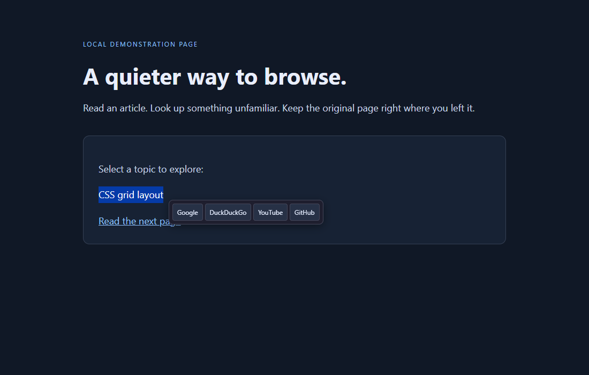
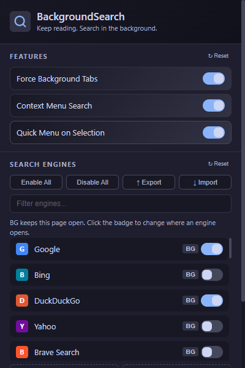
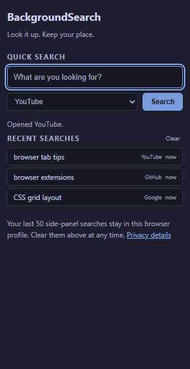

# BackgroundSearch

  

<p align="center">
  <a href="https://ko-fi.com/X8K126YVER">
    
  </a>
</p>

<p align="center">
  <sub><em>If this project helps you, a coffee helps me keep working on it.</em></sub>
</p>

## Look it up. Keep your place.


BackgroundSearch opens search results behind the page you're reading. Select text and choose an engine from the right-click menu, or turn on the small Quick Menu beside your selection. You can also decide which sites should open new tabs in the foreground.

[Download for Chrome](https://github.com/SysAdminDoc/BackgroundSearch/releases/download/v2.7.1/BackgroundSearch-v2.7.1-chrome.zip) · [Firefox temporary package](https://github.com/SysAdminDoc/BackgroundSearch/releases/download/v2.7.1/BackgroundSearch-v2.7.1-firefox.zip) · [Setup guide](docs/guide.md)



*The page is a local demonstration fixture. The floating menu is the installed extension, not a mockup.*

## Search the way you work

Start with Google or choose from 29 presets, including DuckDuckGo, GitHub, YouTube, MDN and Kagi. Only enabled engines appear in search menus.

- **Select once, search elsewhere.** The optional Quick Menu puts your chosen engines beside selected text. Results use each engine's background, foreground or new-window setting.
- Put several engines in a named right-click submenu. Search All opens results for every enabled engine and groups the result tabs in Chrome.
- **Keep useful exceptions.** Set a hostname rule for a site that should always open a foreground tab. Exact names, wildcards and regular expressions are supported.
- Add your own GET or POST engine, import a compatible OpenSearch descriptor, or back up the entire configuration to JSON.



*Installed Chrome extension in a fresh test profile. Provider icons fall back to initials when network requests are unavailable.*

## Install in a few minutes

### Chrome and Chromium

1. Download and extract the **Chrome ZIP** into a permanent folder.
2. Open `chrome://extensions` and enable **Developer mode**. In Edge, use `edge://extensions`.
3. Click **Load unpacked** and select the extracted folder that contains `manifest.json`.
4. Pin BackgroundSearch, open its settings, and enable the engines you use.

Keep that folder in place. To update, export your configuration, replace the files in the same folder with the new Chrome package, then click **Reload** on the extension card. Reload existing web pages so they receive the updated content scripts.

The secondary CRX is intended for compatible self-hosted distribution systems. Use the ZIP for the setup above.

### Firefox

The separate Firefox package requires **Firefox 142 or newer**. Extract it, open `about:debugging#/runtime/this-firefox`, choose **Load Temporary Add-on**, then select its `manifest.json`.

**This is an unsigned temporary add-on. Firefox removes it at restart.** There is no permanent signed Firefox installer in this release. Chrome's side panel and automatic result-tab groups aren't included in the Firefox package. [Mozilla's temporary-installation guide](https://extensionworkshop.com/documentation/develop/temporary-installation-in-firefox/) explains this limitation.

## Useful controls

| Task | Where to find it |
| --- | --- |
| Search from selected text or a link | The page's right-click menu |
| Search without right-clicking | Enable Quick Menu on Selection |
| Open results next to the current tab or at the end | Tab behavior, appearance and site rules |
| Change an engine's result destination | Click its BG, FG or WIN button |
| Search an image URL | Right-click an image and choose a reverse-image provider |
| Search from the address bar | Type `bs`, a space, then the query |
| Look up a query while keeping a page visible | Chrome's side panel, with BackgroundSearch selected |
| Back up settings or restore them | Export and Import in Search Engines |

With YouTube enabled, `bs !yt browser tabs` chooses YouTube. `bs !gh browser tabs` chooses GitHub when enabled. Engine-name prefixes also work. Hold Shift on a normal web page to invert the default foreground/background behavior; an explicit site rule takes priority.

The background-tab toggle is on initially. Context-menu search is on with Google selected. Quick Menu, Search All and middle-click capture start off.



*Installed side-panel content at a narrow panel width, with demonstration searches. The browser's surrounding side-panel frame isn't shown.*

## Privacy and permissions

There is no developer-operated search service. Your selected provider receives the query when you search. Providers have their own privacy policies.

Settings use browser sync storage. If browser sync is enabled, its provider may sync those settings between your devices. The extension keeps engine-use timestamps locally and retains up to 50 side-panel searches in the current browser profile. **Clear** removes that local side-panel list.

Engine icons request favicons from Google's favicon service, including the hostname of a custom engine. Don't add a private hostname if you don't want that hostname used in an icon request. Custom templates can also send the current page URL, title or hostname to your chosen provider.

The extension requests tab access for tab placement and page templates, page access for selection and modifier handling, and clipboard-read access for the explicit **Search clipboard text** action. Clipboard access can be blocked by page or browser restrictions. It isn't read automatically. [Full privacy details](docs/privacy.md) and [feature limits](docs/guide.md#feature-limits) cover the rest.

## Build and check locally

The extension has no runtime package dependencies. Python 3.11 or newer builds the installable ZIPs; Node.js 22 or newer runs the runtime checks.

```text
python -B -m unittest discover -s tests -p test_build.py
node --test tests/runtime.test.cjs
python -B build_extension.py
```

The builder validates both manifests, safely replaces its own `dist` directory and writes separate reloadable folders and ZIPs. It doesn't install or launch a browser. See the [verification notes](docs/verification.md) for real-browser checks and explicit limits.

## Support and project materials

[Report a problem](https://github.com/SysAdminDoc/BackgroundSearch/issues) with your browser version and the steps that reproduce it. Remove private URLs and search terms before sharing a configuration file.

The [concept archive](assets/concepts/README.md) preserves the original artwork, source snapshot and screenshot review attempts. The existing blue search identity is retained. MIT licensed; see [LICENSE](LICENSE).
